<p align="center">
  
</p>

<p align="center">
  
</p>

<p align="center">
  
  
  
  
</p>

## Overview

The API behind the ERP platform: NestJS and PostgreSQL with JWT authentication, role-based access control, tenant isolation, sales and purchase workflows, inventory, treasury, reporting and AI-assisted features. Built to be containerised and deployed with Jenkins and Kubernetes.

## Highlights

- JWT authentication, RBAC and business-level tenant isolation
- Quotes, invoices, sales orders, delivery notes and recurring invoices
- Suppliers, purchase orders, goods receipts and three-way matching
- Inventory movements, warehouse management and product tracking
- Treasury, payments, reporting and scheduled jobs
- Docker, Jenkins pipelines and Kubernetes manifests included

## Tech stack

<p align="center">
  
</p>

## Getting started

**Prerequisites:** Node.js 20+, PostgreSQL and a configured .env file.

```bash
npm install
cp .env.example .env
# configure DB_* and JWT secrets
npm run migration:run
npm run start:dev
```

## Project structure

```text
src/         modules, controllers, services and entities
migrations/  TypeORM migrations
test/        unit and e2e tests
k8s/         deployment manifests
```

## Documentation

- [Original project documentation](docs/README_ORIGINAL.md)

---

<p align="center">
  
</p>

<p align="center">
  Built by <a href="https://github.com/Skander-Bardaoui"><b>Skander Bardaoui</b></a> ·
  <a href="https://skander-bardaoui.netlify.app/">Portfolio</a> ·
  <a href="https://github.com/Skander-Bardaoui?tab=repositories">All repositories</a>
</p>
